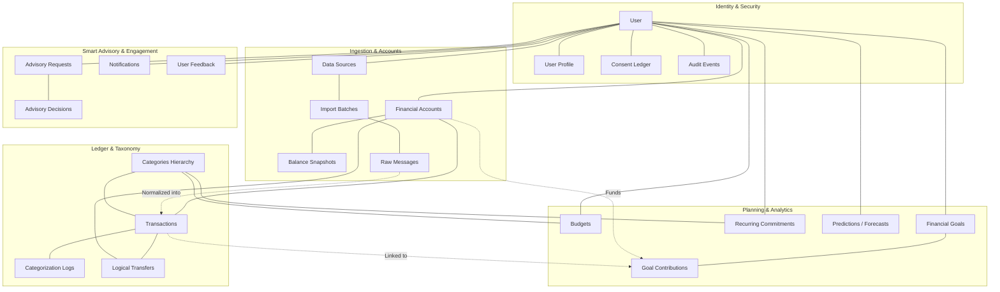
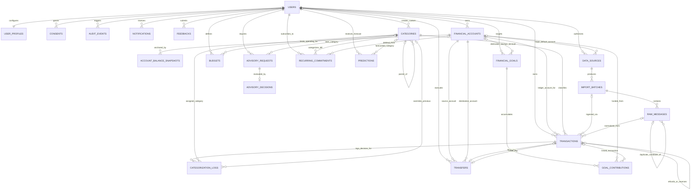
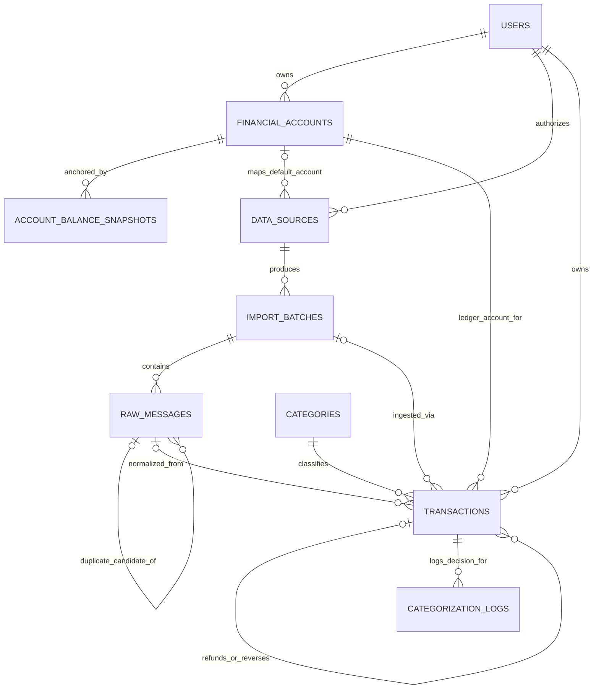
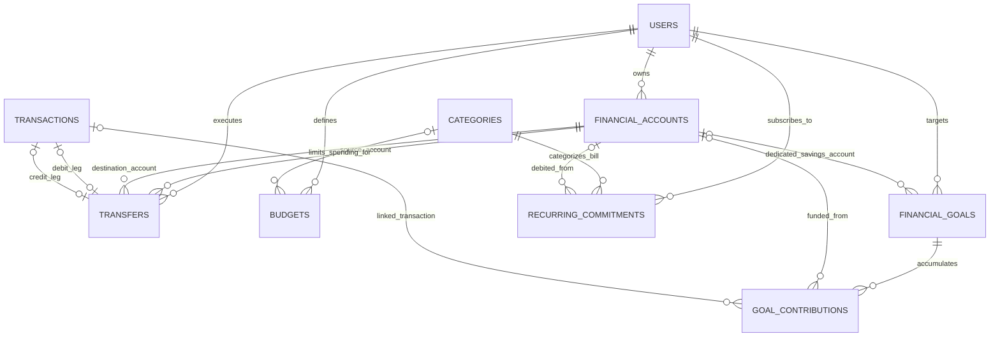
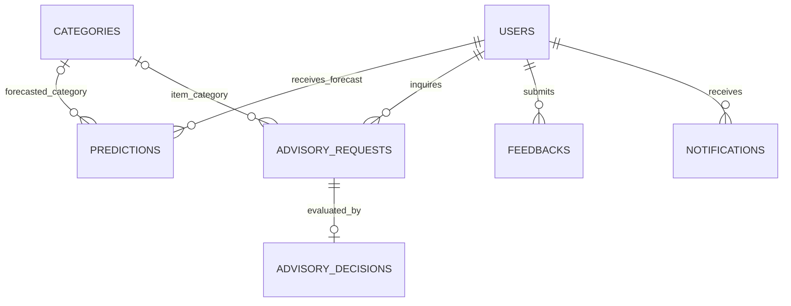

# AI-Powered Personal Finance & Smart Expenditure Advisor
## Comprehensive Database Architecture & PostgreSQL Schema Report (v1.1 - Hardened Edition)

**Document Reference:** DP-DB-ARCH-2026-V1.1  
**Target Systems:** PostgreSQL 14+, Prisma ORM, Node.js / Express.js (JavaScript runtime)  
**Primary Source of Truth:** *AI-Powered Personal Finance & Smart Expenditure Advisor — SRS v1.0*  
**Artifact Files Created in Workspace:**
- [postgresql_schema.sql](file:///c:/Users/Harshit%20Baliyan/Desktop/Finance%20App/postgresql_schema.sql)
- [schema.prisma](file:///c:/Users/Harshit%20Baliyan/Desktop/Finance%20App/schema.prisma)
- [er_diagram.mmd](file:///c:/Users/Harshit%20Baliyan/Desktop/Finance%20App/er_diagram.mmd)
- [er_diagram.dbml](file:///c:/Users/Harshit%20Baliyan/Desktop/Finance%20App/er_diagram.dbml)
- [data_dictionary.md](file:///c:/Users/Harshit%20Baliyan/Desktop/Finance%20App/data_dictionary.md)
- [requirements_traceability.md](file:///c:/Users/Harshit%20Baliyan/Desktop/Finance%20App/requirements_traceability.md)

---

## 1. Executive Summary

This architecture establishes a relational schema and data-access layer for the **AI-Powered Personal Finance & Smart Expenditure Advisor**. It is designed to satisfy the strict requirements of an enterprise financial intelligence platform capable of scaling from an MVP to 25,000+ active users.

Version 1.1 incorporates critical architectural hardening across:
1. **Resilient Deduplication & Multi-Source Reconciliation:** Distinguishes between strong provider references (bank UTRs, check numbers, telephony IDs) which enforce uniqueness, and heuristic fingerprints (amount, time, clean merchant) which identify *candidate duplicates* for review without dropping legitimate consecutive purchases.
2. **Database-Enforced Account Ownership:** Implements composite foreign keys `(user_id, account_id)` and `(user_id, source_id)` across all transactional tables, guaranteeing at the PostgreSQL level that transactions, sources, and batches cannot be linked across user boundaries.
3. **First-Class Logical Transfers (`transfers`):** Models internal transfers as a distinct relation pairing the debit leg and credit leg between two distinct accounts owned by the same user, authoritatively excluding them from consumer expenditure.
4. **Explicit Refund & Reversal Accounting:** Connects refunds and reversals to original purchases (`original_transaction_id`) and establishes formal queries for both **Gross Purchases** and **Net Expenditure**.
5. **Anchor Balance Snapshots (`account_balance_snapshots`):** Solves drift between stored and calculated balances by establishing audited point-in-time snapshots from statements, deriving authoritative balances from snapshot anchors plus subsequent settled ledger increments.
6. **Goal Contribution Ledger (`goal_contributions`):** Replaces unverified mutable progress amounts with an auditable contribution ledger tracking allocations, linked transactions, interest, and withdrawals.

---

## 2. Conceptual ER Diagram



---

## 2.1 Complete Logical ER Diagram



---

## 2.2 Modular Domain Subdiagrams

### Subdiagram A: Ingestion Pipeline & Canonical Transaction Ledger


### Subdiagram B: Planning, Budgets, Goals & Internal Transfers


### Subdiagram C: Predictive Forecasting & Smart Advisory Engine


---

## 3. Resolving the 6 Critical & High Architecture Decisions

### 3.1 Decision 1: Resilient Deduplication & Multi-Source Reconciliation
- **The Problem:** Legitimate distinct purchases frequently share identical amounts, merchants, and timestamps at stored precision (e.g. two cups of coffee bought together, consecutive toll debits, or recurring bills). Furthermore, banks issue identical message templates. Enforcing a hard unique index on `(account_id, amount, timestamp, merchant)` or `(user_id, content_hash)` causes legitimate transactions to be silently dropped!
- **Hardened Architecture:**
  1. **Strong Provider Keys:** Unique constraints are placed ONLY on verified external provider identifiers when present:
     - `raw_messages(source_id, external_message_id) WHERE external_message_id IS NOT NULL`
     - `transactions(account_id, external_reference) WHERE external_reference IS NOT NULL AND deleted_at IS NULL`
  2. **Heuristic Fingerprints as Lookup Indexes:** `reference_hash` on `transactions` and `content_hash` on `raw_messages` are regular B-tree indexes, NOT unique constraints.
  3. **Duplicate Review State Machine:** When an incoming record matches an existing transaction's heuristic fingerprint without a unique external reference, it is assigned `duplicate_status = 'POTENTIAL_DUPLICATE'` and `possible_duplicate_of_id = <existing_id>`, triggering a user or background review task.
  4. **SMS vs. CSV Reconciliation Workflow:**
     - **T0 (Immediate SMS):** SMS arrives with an approximate timestamp, masked account (`*4821`), and raw merchant string. Inserted as `status = 'POSTED'` with `duplicate_status = 'NOT_DUPLICATE'`.
     - **T1 (Monthly CSV Upload):** CSV statement arrives containing cleared dates, exact bank narrations, and reference numbers. The ingestion pipeline queries transactions on `(account_id, amount)` within a ±24-hour window. If a match is found, the system *reconciles* the existing record: updates `posting_date`, populates `external_reference`, links `batch_id`, and sets `status = 'RECONCILED'`. No duplicate row is inserted!

### 3.2 Decision 2: Database-Enforced Account Ownership
- **The Problem:** If `transactions` has `user_id` and `account_id` without composite integrity checks, bugs in backend Express services could insert a transaction for User A referencing an account owned by User B.
- **Hardened Architecture:**
  - Added `UNIQUE (user_id, account_id)` to `financial_accounts`.
  - Added composite foreign keys:
    - `transactions(user_id, account_id) REFERENCES financial_accounts(user_id, account_id) ON DELETE RESTRICT`
    - `data_sources(user_id, account_id) REFERENCES financial_accounts(user_id, account_id) ON DELETE SET NULL`
    - `transfers(user_id, source_account_id) REFERENCES financial_accounts(user_id, account_id) ON DELETE RESTRICT`
    - `transfers(user_id, destination_account_id) REFERENCES financial_accounts(user_id, account_id) ON DELETE RESTRICT`
    - `financial_goals(user_id, account_id) REFERENCES financial_accounts(user_id, account_id) ON DELETE SET NULL`
    - `goal_contributions(user_id, goal_id) REFERENCES financial_goals(user_id, goal_id) ON DELETE CASCADE`
    - `import_batches(user_id, source_id) REFERENCES data_sources(user_id, source_id) ON DELETE CASCADE`
    - `raw_messages(user_id, batch_id) REFERENCES import_batches(user_id, batch_id) ON DELETE CASCADE`
  - Cross-tenant data leakage is physically impossible at the PostgreSQL engine level.

### 3.3 Decision 3: First-Class Logical Internal Transfers (`transfers`)
- **The Problem:** Self-referencing foreign keys on transactions alone cannot guarantee that both sides belong to the same user, that one is debit and the other credit, or that source and destination accounts are distinct.
- **Hardened Architecture:**
  - Created a dedicated `transfers` entity.
  - Links `source_account_id` and `destination_account_id` with `CHECK (source_account_id <> destination_account_id)`.
  - Enforces `UNIQUE (source_transaction_id)` and `UNIQUE (destination_transaction_id)` to establish an exact 1:1 pairing.
  - Transactions involved in transfers are typed as `type = 'TRANSFER'`. Spending queries filtering by `type IN ('DEBIT', 'REFUND', 'REVERSAL')` inherently and cleanly exclude transfers from consumer expenditure calculations.

### 3.4 Decision 4: Explicit Accounting Rules for Refunds and Reversals
- **The Problem:** Summing only `type = 'DEBIT'` ignores refunds, overstating net expenditure.
- **Hardened Architecture:**
  - `transactions.original_transaction_id` self-references the original `DEBIT` purchase.
  - Defined two distinct, authoritative metrics:
    1. **Gross Purchases:** $\sum \text{amount}$ where $\text{type} = \text{'DEBIT'}$. Represents total consumer purchasing activity.
    2. **Net Consumer Expenditure:** $\sum (\text{DEBIT}) - \sum (\text{REFUND}) - \sum (\text{REVERSAL})$. Represents net money drained from household wealth.
  - Category-Wise Attribution: If a refund is linked to an original purchase, it offsets that original purchase's category; if unlinked, it offsets the category explicitly assigned to the refund.

### 3.5 Decision 5: Anchor Balance Snapshots vs. Calculated Balances
- **The Problem:** Storing a single mutable balance column leads to irreversible divergence whenever statement imports are partial, transactions are pending, or opening balances are missing.
- **Hardened Architecture:**
  - Created `account_balance_snapshots`.
  - Sourced from bank statement closing balances or audited manual reconciliations (`as_of_timestamp`, `balance_amount`, `is_reconciled`).
  - Authoritative Balance Formula:
    $$\text{Authoritative Balance}(T) = \text{AnchorBalance}(T_{\text{snapshot}}) + \sum_{t \in (T_{\text{snapshot}}, T]} \Delta(t)$$
    where $\Delta(t) = +\text{amount}$ for settled credits/refunds/transfers-in, and $-\text{amount}$ for settled debits/fees/transfers-out (`status IN ('POSTED', 'RECONCILED')`).
  - `financial_accounts.cached_balance` is maintained only as a high-speed read cache, updated via background workers.

### 3.6 Decision 6: Goal Contribution Ledger as Single Source of Truth
- **The Problem:** Storing a mutable `current_amount` on `financial_goals` lacks an audit trail and drifts over time.
- **Hardened Architecture:**
  - Created `goal_contributions` tracking `ALLOCATION`, `TRANSACTION_LINKED`, `INTEREST`, and `WITHDRAWAL` entries.
  - Progress is derived authoritatively:
    $$\text{Goal Progress} = \sum_{\text{ALLOCATION, TXN, INTEREST}} \text{amount} - \sum_{\text{WITHDRAWAL}} \text{amount}$$
  - `financial_goals.cached_current_amount` is updated atomically upon contribution ledger inserts.

---

## 4. Production SQL Queries

### 4.1 Query: Gross Purchases vs. Net Consumer Expenditure (Accounting for Refunds & Reversals)
```sql
SELECT 
    DATE_TRUNC('month', t.transaction_at) AS month_year,
    c.name AS category_name,
    -- 1. Gross purchases (strictly consumer debits)
    SUM(CASE WHEN t.type = 'DEBIT' THEN t.amount ELSE 0 END) AS gross_purchases,
    -- 2. Inbound refunds and reversals
    SUM(CASE WHEN t.type IN ('REFUND', 'REVERSAL') THEN t.amount ELSE 0 END) AS total_refunds,
    -- 3. Net consumer expenditure
    SUM(CASE 
        WHEN t.type = 'DEBIT' THEN t.amount 
        WHEN t.type IN ('REFUND', 'REVERSAL') THEN -t.amount 
        ELSE 0 
    END) AS net_expenditure
FROM transactions t
JOIN categories c ON t.category_id = c.category_id
WHERE t.user_id = 'a1b2c3d4-0000-0000-0000-000000000001'
  AND t.deleted_at IS NULL
  AND t.status IN ('POSTED', 'RECONCILED')
  AND t.type IN ('DEBIT', 'REFUND', 'REVERSAL') -- Internal transfers and salary credits excluded
  AND t.transaction_at >= '2026-10-01 00:00:00+00'
  AND t.transaction_at < '2026-11-01 00:00:00+00'
GROUP BY DATE_TRUNC('month', t.transaction_at), c.name
ORDER BY net_expenditure DESC;
```

### 4.2 Query: Authoritative Account Balance Calculation (Snapshot + Increments)
```sql
WITH latest_snapshot AS (
    SELECT DISTINCT ON (account_id)
        account_id,
        balance_amount AS anchor_balance,
        as_of_timestamp AS anchor_time
    FROM account_balance_snapshots
    WHERE account_id = 'b1b2c3d4-0000-0000-0000-000000000001'
      AND user_id = 'a1b2c3d4-0000-0000-0000-000000000001'
      AND is_reconciled = TRUE
    ORDER BY account_id, as_of_timestamp DESC
),
subsequent_ledger_movements AS (
    SELECT 
        t.account_id,
        SUM(CASE 
            WHEN t.type IN ('CREDIT', 'REFUND', 'REVERSAL') THEN t.amount
            WHEN t.type IN ('DEBIT', 'FEE') THEN -t.amount
            WHEN t.type = 'TRANSFER' AND tr.destination_account_id = t.account_id THEN t.amount
            WHEN t.type = 'TRANSFER' AND tr.source_account_id = t.account_id THEN -t.amount
            ELSE 0 
        END) AS settled_delta
    FROM transactions t
    LEFT JOIN transfers tr ON t.transaction_id = tr.source_transaction_id 
                           OR t.transaction_id = tr.destination_transaction_id
    JOIN latest_snapshot ls ON t.account_id = ls.account_id
    WHERE t.account_id = 'b1b2c3d4-0000-0000-0000-000000000001'
      AND t.user_id = 'a1b2c3d4-0000-0000-0000-000000000001'
      AND t.deleted_at IS NULL
      AND t.status IN ('POSTED', 'RECONCILED')
      AND t.transaction_at > ls.anchor_time
    GROUP BY t.account_id
)
SELECT 
    fa.account_id,
    fa.account_name,
    ls.anchor_time AS snapshot_as_of,
    ls.anchor_balance AS snapshot_balance,
    COALESCE(slm.settled_delta, 0.00) AS delta_since_snapshot,
    (ls.anchor_balance + COALESCE(slm.settled_delta, 0.00)) AS authoritative_balance,
    fa.cached_balance AS performance_cached_balance
FROM financial_accounts fa
JOIN latest_snapshot ls ON fa.account_id = ls.account_id
LEFT JOIN subsequent_ledger_movements slm ON fa.account_id = slm.account_id;
```

### 4.3 Query: Authoritative Goal Progress (Derived from Contribution Ledger)
```sql
SELECT 
    g.goal_id,
    g.name AS goal_name,
    g.target_amount,
    COALESCE(SUM(CASE 
        WHEN gc.contribution_type IN ('ALLOCATION', 'TRANSACTION_LINKED', 'INTEREST') THEN gc.amount
        WHEN gc.contribution_type = 'WITHDRAWAL' THEN -gc.amount
        ELSE 0
    END), 0.00) AS authoritative_current_amount,
    ROUND((COALESCE(SUM(CASE 
        WHEN gc.contribution_type IN ('ALLOCATION', 'TRANSACTION_LINKED', 'INTEREST') THEN gc.amount
        WHEN gc.contribution_type = 'WITHDRAWAL' THEN -gc.amount
        ELSE 0
    END), 0.00) / g.target_amount) * 100, 2) AS progress_percentage,
    g.target_date,
    GREATEST(1, (g.target_date - CURRENT_DATE) / 30) AS remaining_months,
    ROUND((g.target_amount - COALESCE(SUM(CASE 
        WHEN gc.contribution_type IN ('ALLOCATION', 'TRANSACTION_LINKED', 'INTEREST') THEN gc.amount
        WHEN gc.contribution_type = 'WITHDRAWAL' THEN -gc.amount
        ELSE 0
    END), 0.00)) / GREATEST(1, (g.target_date - CURRENT_DATE) / 30), 2) AS required_monthly_contribution
FROM financial_goals g
LEFT JOIN goal_contributions gc ON g.goal_id = gc.goal_id AND g.user_id = gc.user_id
WHERE g.user_id = 'a1b2c3d4-0000-0000-0000-000000000001'
  AND g.status = 'IN_PROGRESS'
GROUP BY g.goal_id, g.name, g.target_amount, g.target_date;
```

### 4.4 Query: Logical Transfer Verification
```sql
SELECT 
    tr.transfer_id,
    tr.transfer_date,
    tr.amount,
    tr.currency,
    src_fa.account_name AS from_account,
    t_src.amount AS debited_amount,
    dst_fa.account_name AS to_account,
    t_dst.amount AS credited_amount,
    tr.status
FROM transfers tr
JOIN transactions t_src ON tr.source_transaction_id = t_src.transaction_id
JOIN transactions t_dst ON tr.destination_transaction_id = t_dst.transaction_id
JOIN financial_accounts src_fa ON tr.source_account_id = src_fa.account_id
JOIN financial_accounts dst_fa ON tr.destination_account_id = dst_fa.account_id
WHERE tr.user_id = 'a1b2c3d4-0000-0000-0000-000000000001'
  AND tr.status = 'SETTLED'
ORDER BY tr.transfer_date DESC;
```

### 4.5 Query: Potential Duplicate Identification & Review Queue
```sql
SELECT 
    t.transaction_id,
    t.transaction_at,
    t.amount,
    t.clean_merchant_name,
    t.description,
    t.duplicate_status,
    existing.transaction_id AS matching_existing_id,
    existing.transaction_at AS existing_time,
    existing.description AS existing_description,
    rm.sanitized_preview AS source_message_preview
FROM transactions t
JOIN transactions existing ON t.possible_duplicate_of_id = existing.transaction_id
LEFT JOIN raw_messages rm ON t.raw_message_id = rm.message_id
WHERE t.user_id = 'a1b2c3d4-0000-0000-0000-000000000001'
  AND t.duplicate_status = 'POTENTIAL_DUPLICATE';
```

---

## 5. Summary of Schema Changes Across Files

| Schema Entity / Aspect | v1.0 Approach | v1.1 Hardened Approach | Justification |
| :--- | :--- | :--- | :--- |
| **Transaction Deduplication** | Hard unique index on `(account_id, reference_hash)`. | Unique index on `external_reference` only. `reference_hash` is non-unique index with `duplicate_status` review state. | Prevents silent dropping of valid consecutive identical purchases. |
| **Account Ownership** | Independent FKs to `users` and `financial_accounts`. | Composite FKs `(user_id, account_id)` on `transactions`, `sources`, `transfers`, `goals`. | Database engine level prevention of cross-user account linkage. |
| **Internal Transfers** | Self-referential `transfer_pair_id` on `transactions`. | First-class `transfers` table with `CHECK (source <> dest)` and 1:1 transaction binds. | Enforces identical user ownership and guarantees complete exclusion from spending. |
| **Refunds & Reversals** | Single `type = 'DEBIT'` query. | `original_transaction_id` tracking with explicit **Gross Purchases** and **Net Expenditure** SQL definitions. | Accurately accounts for returned items and reversed bank debits. |
| **Account Balances** | Single mutable `current_balance` column. | `account_balance_snapshots` point-in-time anchors; authoritative balance derived from anchor + settled increments. | Eliminates balance drift from partial imports and pending transactions. |
| **Goal Progress** | Mutable `current_amount` column. | `goal_contributions` audit ledger tracking allocations, transaction links, interest, and withdrawals. | Authoritative source of truth for savings progress with complete history. |

---

## 6. Architect's Sign-Off & Verification

All 6 critical and high items have been resolved and synchronized across:
- [postgresql_schema.sql](file:///c:/Users/Harshit%20Baliyan/Desktop/Finance%20App/postgresql_schema.sql)
- [schema.prisma](file:///c:/Users/Harshit%20Baliyan/Desktop/Finance%20App/schema.prisma)
- [er_diagram.mmd](file:///c:/Users/Harshit%20Baliyan/Desktop/Finance%20App/er_diagram.mmd)
- [er_diagram.dbml](file:///c:/Users/Harshit%20Baliyan/Desktop/Finance%20App/er_diagram.dbml)
- [data_dictionary.md](file:///c:/Users/Harshit%20Baliyan/Desktop/Finance%20App/data_dictionary.md)
- [requirements_traceability.md](file:///c:/Users/Harshit%20Baliyan/Desktop/Finance%20App/requirements_traceability.md)
- [database_design_report.md](file:///c:/Users/Harshit%20Baliyan/Desktop/Finance%20App/database_design_report.md)
